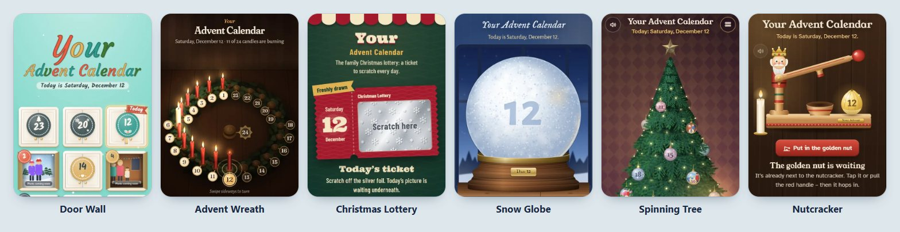

# Your Advent Calendar

*[Deutsch](README.md) · English*

**A photo Advent calendar for the family: a photo every day of Advent – and twelve playful ways to open it.**

<p align="center">
  
</p>

**Live demo:** [theapo.github.io/adventskalender/](https://theapo.github.io/adventskalender/)

Runs on any simple web space – no PHP, no database, no trackers. German and English, switchable.<br>
made by Dirk Aporius · [www.apo-games.de](https://www.apo-games.de)

## The 12 views

| View | `id` | How it works |
|---|---|---|
| Door Wall | `tueren` | 24 cardboard doors to open |
| Bauble Garlands | `girlande` | Christmas baubles on fir garlands |
| Advent Wreath | `kranz` | one more candle burns every day |
| Christmas Lottery | `rubbellos` | scratch off a ticket every day |
| Photo Line | `fotoleine` | envelopes with instant photos on the fairy lights |
| Advent Stories | `stories` | several photos per day, tapped through like on a phone |
| Snow Globe | `schneekugel` | shake until the photo appears |
| Spinning Tree | `baum` | spin a 3D Christmas tree, find the bauble |
| Unwrap Presents | `geschenk` | pull the bow, tear the paper |
| Nutcracker | `nuss` | pull the lever until the nut cracks |
| Constellations | `sterne` | connect the stars into a constellation |
| Build Snow Figures | `schneemann` | roll a different snow figure every day |

Every view has a snowflake at the bottom left: the menu for switching the view and the language.

## Publish your own calendar

You need: a computer (Windows, Mac or Linux), 24 pictures and some web space.
The commands and folder names are German – just type them as shown.

1. **Install Node.js** – version 20.9 or newer, “LTS” from [nodejs.org](https://nodejs.org).
2. **Download the project** – on GitHub “Code → Download ZIP” and unpack (or `git clone`). Open a terminal in the
   folder and run `npm install` once.
3. **Put your pictures in `bilder/`** – one per day: `1.jpg`, `2.jpg` … `24.jpg` (no leading zero; JPG, PNG or WebP).
   Optional: `bilder/texte.txt` with captions (`12 = Baking cookies`), folder `bilder/12/` with single photos for the
   “Advent Stories” view.
4. **Edit `einstellungen.json`:**

   ```json
   {
     "titel": { "de": "Omas Adventskalender", "en": "Grandma’s Advent Calendar" },
     "jahr": 2026,
     "ansichten": "alle",
     "standard_ansicht": "tueren",
     "sprachen": ["de", "en"],
     "sprache": "auto",
     "testschluessel": "christmas-tree-7341"
   }
   ```

   `titel` = heading (text, or one per language) · `jahr` = year of Advent · `ansichten` = `"alle"` (all), `["kranz"]`
   (just one) or your selection · `standard_ansicht` = the view it starts with · `sprachen` = languages to offer ·
   `sprache` = `"auto"` (browser language on the first visit) or e.g. `"en"` · `testschluessel` = test key for trying it
   out before December (empty = no test mode).
5. **Build and preview:** `npm run bauen`, then `npm run ansehen` and open the address shown. Before December 1
   everything is closed – that’s right. To try it out, open `http://localhost:8080/?test=christmas-tree-7341`
   (your test key): the snowflake menu then has a date slider. `?test=aus` ends test mode.
6. **Upload** the **contents** of `ausgabe/` to your web space, e.g. into `/advent/`, and send the address to your family.

**Another language:** copy `kalender/i18n/en.json` to e.g. `fr.json`, translate the texts and add `"fr"` to `sprachen`.
Missing texts appear in German; `npm run bauen` tells you how many are missing.

## Good to know

- **Privacy:** everything stays on your web space, fonts included. No trackers, no third-party servers.
- **Progress per device:** each browser remembers which days are already open.
- **Not a vault:** the date comes from the device – good enough for curious kids.
- **Demo (`docs/`):** built with painted placeholder pictures, rebuild with `npm run demo`; on GitHub
  Settings → Pages → branch `main`, folder `/docs`.

## License

**Non-commercial use only:** [CC BY-NC 4.0](https://creativecommons.org/licenses/by-nc/4.0/) – use it privately,
adapt it and share it, as long as “made by Dirk Aporius · www.apo-games.de” is credited. No selling, no paid services;
for commercial use please ask first. Details: [LICENSE](LICENSE). The fonts have their own free licenses, see
[`kalender/fonts/LIZENZEN.md`](kalender/fonts/LIZENZEN.md).

---

Your Advent Calendar – made by Dirk Aporius · [www.apo-games.de](https://www.apo-games.de)
