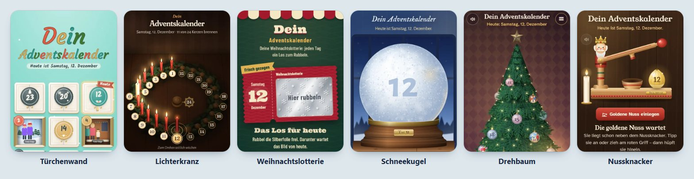

# Dein Adventskalender

*Deutsch · [English](README.en.md)*

**Ein Foto-Adventskalender für die Familie: jeden Tag im Advent ein Foto – und zwölf verspielte Arten, es zu öffnen.**

<p align="center">
  
</p>

**Live-Demo:** [theapo.github.io/adventskalender/](https://theapo.github.io/adventskalender/)

Läuft auf jedem einfachen Webspace – ohne PHP, ohne Datenbank, ohne Tracker.<br>
made by Dirk Aporius · [www.apo-games.de](https://www.apo-games.de)

## Die 12 Ansichten

| Ansicht | `id` | So geht’s |
|---|---|---|
| Türchenwand | `tueren` | 24 Kartontürchen zum Aufklappen |
| Kugel-Girlanden | `girlande` | Christbaumkugeln an Tannengirlanden |
| Lichterkranz | `kranz` | jeden Tag brennt eine Kerze mehr |
| Weihnachtslotterie | `rubbellos` | jeden Tag ein Rubbellos freirubbeln |
| Fotoleine | `fotoleine` | Umschläge mit Sofortbild an der Lichterkette |
| Advent-Stories | `stories` | mehrere Fotos je Tag, durchgetippt wie am Handy |
| Schneekugel | `schneekugel` | schütteln, bis das Foto auftaucht |
| Drehbaum | `baum` | Tannenbaum in 3D drehen, Kugel finden |
| Geschenke auspacken | `geschenk` | Schleife ziehen, Papier aufreißen |
| Nussknacker | `nuss` | am Hebel ziehen, bis die Nuss knackt |
| Sternbilder | `sterne` | Sterne zum Sternbild verbinden |
| Schneefiguren bauen | `schneemann` | jeden Tag eine andere Schneefigur rollen |

Unten links sitzt in jeder Ansicht eine Schneeflocke: das Menü zum Umschalten der Ansicht und der Sprache (Deutsch/Englisch).

## Deinen eigenen Kalender veröffentlichen

Du brauchst: einen PC (Windows, Mac oder Linux), 24 Bilder und einen Webspace.

**1. Node.js installieren** – Version 20.9 oder neuer, „LTS“ von [nodejs.org](https://nodejs.org).

**2. Projekt herunterladen** – auf GitHub „Code → Download ZIP“ und entpacken (oder `git clone`).
Im Ordner ein Terminal öffnen (Windows: im Explorer in die Adresszeile `cmd` tippen) und einmalig die
Bildbibliothek holen:

```
npm install
```

**3. Bilder in den Ordner `bilder/` legen** – je Tag eins: `1.jpg`, `2.jpg` … `24.jpg`.

- ohne führende Null (`7.jpg`, nicht `07.jpg`) · JPG, PNG oder WebP · gut sind 1200–2400 px
- optional `bilder/texte.txt` mit Bildunterschriften, eine Zeile je Tag: `12 = Plätzchen backen`
- optional Ordner `bilder/12/` mit Einzelfotos – die zeigt die Ansicht „Advent-Stories“ nacheinander

Mehr dazu: [`bilder/LIES-MICH.md`](bilder/LIES-MICH.md).

**4. `einstellungen.json` anpassen** (mit einem Texteditor):

```json
{
  "titel": "Omas Adventskalender",
  "jahr": 2026,
  "ansichten": "alle",
  "standard_ansicht": "tueren",
  "sprachen": ["de", "en"],
  "sprache": "auto",
  "testschluessel": "tannenbaum-7341"
}
```

| Feld | Bedeutung |
|---|---|
| `titel` | Überschrift – kurz halten, z. B. zwei Wörter; je Sprache: `{ "de": "Omas Adventskalender", "en": "Grandma’s Advent Calendar" }` |
| `jahr` | der Advent, für den der Kalender gilt |
| `ansichten` | `"alle"` = alle 12, umschaltbar über die Schneeflocke<br>`["kranz"]` = nur diese eine Ansicht, ohne Umschalten<br>`["tueren", "kranz", "schneekugel"]` = deine Auswahl |
| `standard_ansicht` | damit startet der Kalender – muss in `ansichten` vorkommen |
| `sprachen` | `["de", "en"]` = umschaltbar über die Schneeflocke, `["de"]` = nur Deutsch |
| `sprache` | `"auto"` = beim ersten Besuch die Sprache des Browsers, sonst z. B. `"de"` |
| `testschluessel` | zum Ausprobieren vor Dezember (leer = kein Testmodus) |

**5. Bauen und ansehen**

```
npm run bauen
npm run ansehen
```

Dann die angezeigte Adresse öffnen (meist http://localhost:8080). Vor dem 1. Dezember ist alles zu – richtig so.
Zum Durchprobieren `http://localhost:8080/?test=tannenbaum-7341` aufrufen (dein Testschlüssel): Im Menü
(Schneeflocke unten links) erscheint ein Datumsregler. `?test=aus` beendet den Testmodus wieder.

**6. Hochladen** – den **Inhalt** von `ausgabe/` per FTP auf deinen Webspace kopieren, in einen beliebigen
Ordner, z. B. `/advent/`. Fertig: `https://deine-seite.de/advent/` an die Familie schicken.

> Ohne eigenen Webspace geht es auch mit GitHub Pages oder Netlify (Inhalt von `ausgabe/` dort hochladen).
> Dann liegen deine Fotos öffentlich im Netz: Nur zufällige Dateinamen schützen sie vor dem Erraten,
> und das Datum rechnet der Browser aus.

**Bilder später austauschen:** Bild in `bilder/` ersetzen, `npm run bauen`, `ausgabe/` neu hochladen
(den alten Ordner `web/` auf dem Server vorher löschen).

## Gut zu wissen

- **Datenschutz:** Alles liegt auf deinem Webspace, auch die Schriften. Keine Tracker, keine fremden Server.
- **Fortschritt pro Gerät:** Welche Tage schon offen sind, merkt sich jeder Browser selbst.
- **Kein Tresor:** Das Datum kommt vom Gerät. Wer die Uhr vorstellt oder im Quelltext stöbert, kann vorspicken –
  gegen neugierige Kinder reicht es.
- **Nicht per Doppelklick öffnen** (`file://`), sondern immer über einen Webserver (`npm run ansehen`).
- **Nächstes Jahr:** `jahr` ändern, neue Bilder hinein, neu bauen – alle Tage sind dann wieder zu.
- **Weitere Sprache:** `kalender/i18n/en.json` nach z. B. `fr.json` kopieren, die Texte übersetzen und `"fr"` bei
  `sprachen` eintragen. Fehlende Texte erscheinen auf Deutsch; `npm run bauen` sagt, wie viele fehlen.

## Die Demo (`docs/`)

`docs/` ist die fertig gebaute Demo mit gemalten Platzhalter-Bildern. Neu bauen: `npm run demo`.
Online stellen: auf GitHub **Settings → Pages → Deploy from a branch**, Branch `main`, Ordner `/docs`.

## Was liegt wo?

| Ordner | Inhalt |
|---|---|
| `bilder/` | deine Bilder (bleiben privat) |
| `kalender/` | die Ansichten, Bausteine, Schriften, Vorlagen und Texte je Sprache (`kalender/i18n/`) |
| `werkzeuge/` | `bauen.mjs`, `ansehen.mjs`, `demo-bauen.mjs` |
| `ausgabe/` | dein fertiger Kalender – das lädst du hoch |
| `docs/` | die Demo für GitHub Pages |

## Lizenz

**Nur für nicht-kommerzielle Nutzung:** [CC BY-NC 4.0](https://creativecommons.org/licenses/by-nc/4.0/deed.de) – privat nutzen, anpassen und weitergeben ist ausdrücklich erwünscht, solange „made by Dirk Aporius · www.apo-games.de“ genannt wird. Kein Verkauf, keine bezahlten Dienste; für kommerzielle Nutzung bitte vorher fragen. Details: [LICENSE](LICENSE). Die Schriften haben eigene freie Lizenzen, siehe
[`kalender/fonts/LIZENZEN.md`](kalender/fonts/LIZENZEN.md).

---

Dein Adventskalender – made by Dirk Aporius · [www.apo-games.de](https://www.apo-games.de)
